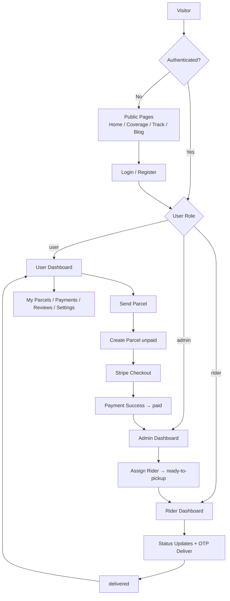
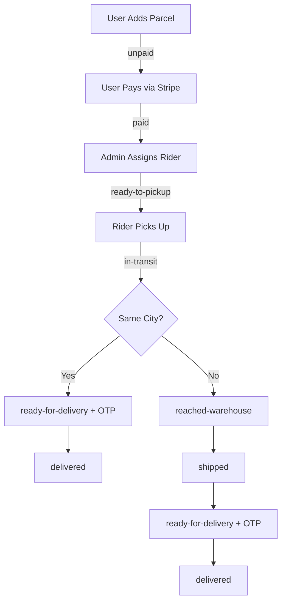

# Zap Shift 🚚

**Door-to-Door Parcel Management & Courier Platform**

A modern, full-stack parcel delivery platform for Bangladesh (64 districts). Customers book and pay for parcels, riders collect and deliver with OTP confirmation, and admins assign riders and oversee operations.

---

## Live Links

| Resource | Link |
|----------|------|
| **Live Frontend** | [https://zap-shift-737f5.web.app](https://zap-shift-737f5.web.app/) |
| **Backend API** | [https://zap-shift-server-delta-smoky.vercel.app](https://zap-shift-server-delta-smoky.vercel.app/) |
| **GitHub Monorepo** | [github.com/kaziashik/zap-shift](https://github.com/kaziashik/zap-shift) |
| **Frontend Code** | [`/frontend`](./frontend) |
| **Backend Code** | [`/backend`](./backend) |
| **API Documentation** | [`resources/API_DOCUMENTATION.md`](./resources/API_DOCUMENTATION.md) |
| **Postman Collection** | [`resources/zap-shift-server.postman_collection.json`](./resources/zap-shift-server.postman_collection.json) |

---

## Project Overview

Zap Shift is a responsive **React + Express** application for door-to-door courier operations across Bangladesh. Customers create parcels with pickup and delivery details, pay via Stripe, and track status in real time. Riders manage assigned pickups and deliveries (including warehouse handoff for inter-district). Admins approve riders, assign parcels, and monitor platform analytics.

> 💡 **Note:** This project includes both frontend and backend in one monorepo. The frontend consumes the Zap Shift REST API (local or deployed) and uses Firebase Auth for identity.

> ⚠️ **Note:** Treat the original assignment requirements as a strong guide. Features may be extended or adjusted to match a production-ready implementation strategy.

---

## Why This Project Was Created

### Problem Statement

Local courier booking is often offline, pricing is unclear, and tracking is hard to follow. Customers lack a simple digital flow from book → pay → track → review. Operators need role-based tools for rider approval, assignment, and delivery confirmation.

### Solution

Zap Shift connects:
- **Users** who want reliable door-to-door shipping
- **Riders** who collect, transit, and deliver parcels
- **Admins** who keep logistics safe and organized

The goal is a clean, secure courier experience from **send → pay → assign → deliver (OTP) → review**.

---

## Features Available on the Website

### Public Features
- Responsive landing page (banner, services, pricing, FAQ, reviews, CTA)
- Coverage map for service centers / districts (Leaflet)
- Explore, About, Blog, Help, Contact, Privacy, and Terms pages
- Public parcel tracking by tracking ID
- Dark / light theme support

### User (Customer) Features
- Register / Login (email-password + Google Sign-In)
- Role-based dashboard after login
- Send parcel form (type, weight, sender/receiver, service centers)
- Dynamic pricing with server-side re-validation
- Stripe Checkout payment flow
- Payment success / cancel pages
- My Parcels table (pay, edit, delete unpaid, track)
- Payment history
- Profile / settings update
- Post-delivery service reviews

### Rider Features
- Apply to become a rider (pending admin approval)
- Rider dashboard with delivery stats / charts
- Assigned deliveries with status updates
- Same-city vs outside-city workflow (warehouse handoff)
- OTP generation and confirmation on final delivery
- Completed deliveries + commission view (৳80% same city · ৳60% outside)

### Admin Features
- Global platform analytics and charts
- Approve / reject rider applications
- Assign pickup / delivery riders to paid parcels
- Users management (search, role updates)
- Operational oversight of parcel status pipeline

### Platform / Security Features
- Firebase Authentication (ID tokens)
- Express middleware: `verifyFBToken`, `verifyAdmin`, `verifyRider`
- Role-based route guards on the frontend (`PrivateRoute`, `AdminRoute`, `RiderRoute`)
- Stripe session verification before marking a parcel **paid**
- OTP hashed confirmation for delivery proof
- Tracking event logs for every status change

---

## Roles & Permissions

| Role | Description | Frontend UI Expectations |
|------|-------------|--------------------------|
| **User** | Customers who send parcels | Send parcel, pay, track, payment history, review after delivery |
| **Rider** | Delivery agents | Assigned / completed deliveries, status updates, OTP delivery confirm |
| **Admin** | Platform operators | Approve riders, assign riders, users management, analytics |

---

## Walkthrough — How to Go Through the Project

### User Journey
```text
Register / Login
    → Send Parcel (/send-parcel)
    → Confirm Cost → Parcel Created (unpaid)
    → Dashboard → My Parcels → Pay
    → Stripe Checkout
    → Payment Success
    → Track Parcel (/parcel-track/:trackingId)
    → After Delivery → Leave Review
```

### Rider Journey
```text
Apply as Rider (/rider)
    → Wait for Admin Approval
    → Rider Dashboard
    → Assigned Deliveries
    → Update Status (Pickup → Transit → … → Deliver)
    → Enter OTP on Delivered
    → Completed Deliveries / Earnings
```

### Admin Journey
```text
Login as Admin
    → Admin Dashboard (stats / analytics)
    → Approve Riders
    → Assign Riders to Paid Parcels
    → Manage Users
```

### Parcel Status Pipeline
| Status | Meaning |
|--------|---------|
| `unpaid` | Parcel created; awaiting payment |
| `paid` | Stripe payment verified |
| `ready-to-pickup` | Admin assigned rider(s) |
| `in-transit` | Rider picked up the parcel |
| `ready-for-delivery` | Same-city: out for delivery (+ OTP) |
| `reached-warehouse` | Outside-city: handed to origin warehouse |
| `shipped` | Parcel shipped toward destination |
| `delivered` | OTP confirmed; delivery complete |

### Pricing Structure

| Parcel Type | Weight | Within City | Outside City/District |
|-------------|--------|-------------|------------------------|
| **Document** | Any | ৳60 | ৳80 |
| **Non-Document** | Up to 3kg | ৳110 | ৳150 |
| **Non-Document** | >3kg | +৳40/kg | +৳40/kg +৳40 extra |

Pricing is calculated on the client and **re-validated on the server** when a parcel is created.

### Rider Commission
| Route Type | Payout |
|------------|--------|
| Same city | **80%** of parcel cost |
| Outside city | **60%** of parcel cost |

---

## Tech Stack

### Frontend
| Area | Technology |
|------|------------|
| Framework | **React 19** + **Vite** |
| Routing | **React Router 7** |
| Styling | **Tailwind CSS 4** + **DaisyUI** |
| Server state | **TanStack Query** |
| HTTP | **Axios** (secure instance with Firebase token) |
| Auth | **Firebase Auth** (email + Google) |
| Forms | **React Hook Form** |
| Maps | **Leaflet** / **React-Leaflet** |
| Charts | **Recharts** |
| Alerts | **SweetAlert2** |
| Carousel | **Swiper** / **react-responsive-carousel** |
| Animation | **Motion** |
| Icons | **React Icons** |
| Theme | Custom Theme Context (dark / light) |

### Backend
| Area | Technology |
|------|------------|
| Runtime | **Node.js** |
| Framework | **Express 5** |
| Database | **MongoDB** (native driver + Atlas) |
| Auth | **Firebase Admin SDK** (verify ID tokens) |
| Payments | **Stripe** Checkout Sessions |
| Config | **dotenv**, **cors** |
| Deploy | **Vercel** (serverless) |

### Design System
- Brand courier look with DaisyUI components
- Dark + light mode
- Responsive, mobile-first layouts
- Dashboard tables, status badges, and Recharts analytics
- Coverage map for nationwide service awareness

---

## Project Flowchart



### High-level Architecture
```text
Browser (React + Vite Frontend)
        |  Firebase ID token + Axios
        v
Express API (backend)
        |
        +--> MongoDB Atlas (users, parcels, riders, payments, trackings, reviews)
        +--> Firebase Admin (token verify)
        +--> Stripe (checkout + payment verify)
```

### Delivery Workflow (Same City vs Outside)



---

## Folder Structure

### Monorepo Root
```text
zap-shift/
├── backend/              # Express + MongoDB API
├── frontend/             # React + Vite application
├── resources/            # Specs, Postman, sample data, deploy notes
├── package.json          # Root helper scripts
└── README.md
```

### Backend (`backend/`)
```text
backend/
├── config/               # database.js, firebase.js
├── controllers/          # parcel, payment, rider, tracking, user, contact, review
├── middleware/           # auth, collections, logging, validate, errorHandler
├── models/               # User, Parcel, Rider, Payment, Tracking, Contact, Review
├── routes/               # users, parcels, riders, payments, trackings, reviews, contact
├── utils/                # trackingId, pricing, deliveryStatus
├── index.js
├── package.json
├── vercel.json
└── SETUP.md
```

### Frontend (`frontend/`)
```text
frontend/
├── public/
├── src/
│   ├── components/       # Logo, cards, dashboard UI, theme toggle
│   ├── contexts/         # Auth + Theme providers
│   ├── data/             # serviceCenters, services, reviews
│   ├── firebase/         # Firebase client init
│   ├── hooks/            # useAuth, useAxios, useAxiosSecure, useRole
│   ├── layouts/          # Root, Auth, Dashboard layouts
│   ├── pages/            # Home, Auth, Coverage, SendParcel, Dashboard, …
│   └── routes/           # router, PrivateRoute, AdminRoute, RiderRoute
├── package.json
└── vite.config.js
```

---

## Installation & Setup (Clear Instructions)

### Prerequisites
- Node.js 18+
- npm
- MongoDB Atlas account (or compatible MongoDB)
- Firebase project (Auth + Admin service account)
- Stripe test keys (for payments)

### 1) Clone the repository
```bash
git clone https://github.com/kaziashik/zap-shift.git
cd zap-shift
```

### 2) Setup Backend
```bash
cd backend
npm install
```

Create `backend/.env`:
```env
PORT=5001
DB_USER=your_mongodb_username
DB_PASS=your_mongodb_password
FB_SERVICE_KEY=your_base64_encoded_firebase_service_account_json
STRIPE_SECRET_KEY=sk_test_xxx
SITE_DOMAIN=http://localhost:5173
CLIENT_URL=http://localhost:5173
```

> Convert the Firebase service account JSON to base64 and put it in `FB_SERVICE_KEY` (see `backend/SETUP.md`).

Then:
```bash
npm run dev
```

Backend runs at: **http://localhost:5001**

### 3) Setup Frontend
```bash
cd ../frontend
npm install
```

Create `frontend/.env`:
```env
VITE_apiKey=your_firebase_api_key
VITE_authDomain=your_project.firebaseapp.com
VITE_projectId=your_project_id
VITE_storageBucket=your_project.appspot.com
VITE_messagingSenderId=your_sender_id
VITE_appId=your_app_id
VITE_API_URL=http://localhost:5001
VITE_image_host_key=optional_imgbb_key
```

Then:
```bash
npm run dev
```

Frontend runs at: **http://localhost:5173**

### Root helpers
```bash
npm run install:all
npm run dev:backend
npm run dev:frontend
npm run build:frontend
```

---

## Demo Accounts

| Role | Email | Password |
|------|-------|----------|
| Admin | `demo@zapshift.com` | `Demo@12345` |
| User | `user@zapshift.com` | `User@12345` |
| Rider | `rider@zapshift.com` | `Rider@12345` |

Use **Demo login (auto-fill)** on the Login page for the admin account, or sign in manually with any role above.

---

## Key Frontend Routes

| Route | Feature |
|-------|---------|
| `/` | Home / landing |
| `/coverage` | Nationwide coverage map |
| `/send-parcel` | Create a parcel (auth) |
| `/parcel-track/:trackingId` | Public tracking timeline |
| `/login` / `/register` | Auth |
| `/rider` | Apply as rider |
| `/dashboard` | Role-based dashboard home |
| `/dashboard/my-parcels` | User parcels + pay / track |
| `/dashboard/payment/:parcelId` | Stripe payment initiation |
| `/dashboard/payment-success` / `payment-cancelled` | Payment outcome |
| `/dashboard/payment-history` | User payment history |
| `/dashboard/assigned-deliveries` | Rider active jobs |
| `/dashboard/completed-deliveries` | Rider completed jobs |
| `/dashboard/approve-riders` | Admin rider approval |
| `/dashboard/assign-riders` | Admin parcel assignment |
| `/dashboard/users-management` | Admin users |
| `/dashboard/analytics` | Admin analytics |

---

## API Endpoints (Summary)

**Base URL (production):** `https://zap-shift-server-delta-smoky.vercel.app`  
**Local:** `http://localhost:5001`

| Area | Prefix | Notes |
|------|--------|-------|
| Users | `/users` | Create user, get role, admin role update |
| Parcels | `/parcels` | CRUD-ish lifecycle, rider list, status + OTP |
| Payments | `/payment-checkout-session`, `/payment-success`, `/payments` | Stripe create + verify |
| Riders | `/riders` | Apply, list, approve, rider stats |
| Trackings | `/trackings/:trackingId/logs` | Status timeline |
| Reviews | `/reviews` | Public list + authenticated create |
| Contact | `/contact` | Contact form submissions |

> 🔒 Most mutating routes require `Authorization: Bearer <Firebase ID token>`. Admin/Rider actions also check MongoDB role after token verify.

Full details: [`resources/API_DOCUMENTATION.md`](./resources/API_DOCUMENTATION.md)

---

## Packages Used (Summary)

### Frontend notable packages
`react`, `vite`, `react-router`, `tailwindcss`, `daisyui`, `@tanstack/react-query`, `axios`, `firebase`, `react-hook-form`, `leaflet`, `react-leaflet`, `recharts`, `sweetalert2`, `swiper`, `motion`, `react-icons`

### Backend notable packages
`express`, `mongodb`, `firebase-admin`, `stripe`, `cors`, `dotenv`

---

## License

Educational / portfolio project. Use and adapt freely with attribution appreciated.

---

## Author

**Ashik (kaziashik)**  
GitHub: [github.com/kaziashik](https://github.com/kaziashik)
